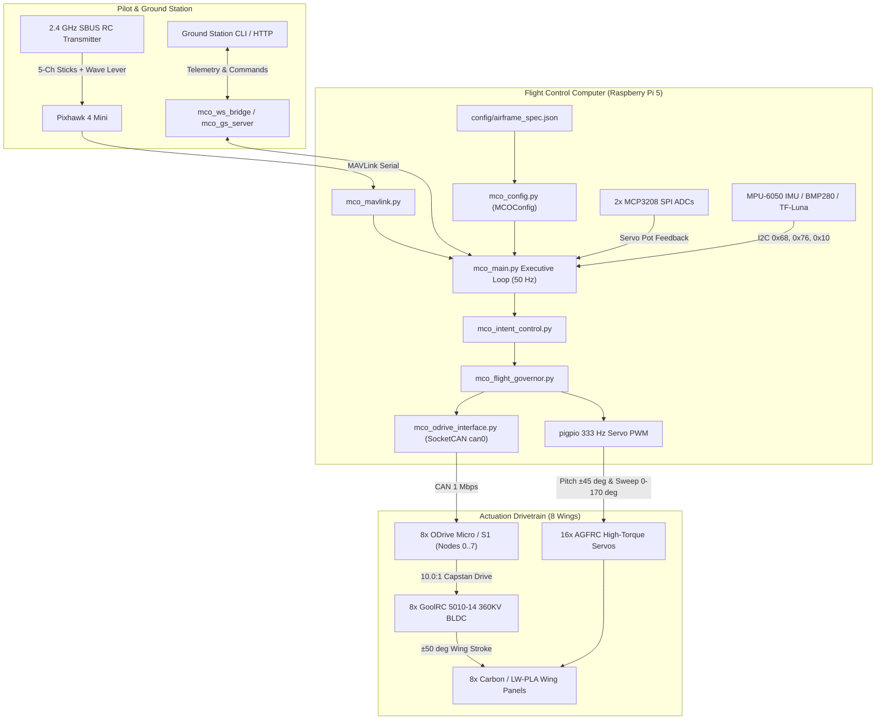

# MCO-1D Metachronal Cascade Ornithopter

8-wing tandem-staggered flapping-wing research drone CAD and flight software.

[](https://www.python.org/downloads/)
[](LICENSE)
[](cad/print_package_wing_root/README_3D_PRINT_GUIDE.md)

## Table of Contents

- [1. System Overview](#1-system-overview)
- [2. Technical Specifications & Single Source of Truth](#2-technical-specifications--single-source-of-truth)
- [3. V10 Wing Root Mechanism & Parametric CAD](#3-v10-wing-root-mechanism--parametric-cad)
- [4. 3D Print Package & Slicing Specifications](#4-3d-print-package--slicing-specifications)
- [5. Unified Pilot Control Architecture](#5-unified-pilot-control-architecture)
- [6. Developer Workflow & CLI (`./mco`)](#6-developer-workflow--cli-mco)
- [7. Repository Layout](#7-repository-layout)
- [License](#license)

---

## 1. System Overview

The **MCO-1D** is an experimental 8-wing unmanned aerial vehicle employing four tandem-staggered wing pairs ($W_1$ to $W_4$, Port and Starboard) driven in a metachronal flapping wave. Each wing is actuated in 3 degrees of freedom: flapping via a brushless motor and `10.0:1` stepped Dyneema capstan reduction, plus pitch feathering and sweep folding via a 2-DOF differential bevel wrist driven by two high-voltage servos.



---

## 2. Technical Specifications & Single Source of Truth

All authoritative design parameters live in [`config/airframe_spec.json`](config/airframe_spec.json) (loaded in Python via [`firmware/mco_config.py`](firmware/mco_config.py)) and [`bom/bom.csv`](bom/bom.csv) (generated by [`scripts/mco_bom_tool.py`](scripts/mco_bom_tool.py)). Unmeasured physical quantities are marked `TBD (measure on hardware)` until recorded from physical bench and scale measurements.

| Parameter | Value / Specification | Source of Truth / Notes |
| :--- | :--- | :--- |
| **Designation** | MCO-1D Mark 1 | 8-wing tandem-staggered research airframe |
| **Installed BOM Mass** | **3.642 kg (3,642 g)** | Computed from 39 line items in [`bom/bom.csv`](bom/bom.csv) (`$3,757.58` total procurement with spares) |
| **As-Built Weighed Mass** | `TBD (measure on hardware)` | Record on [`MCO-1D_Mark1_Builder_Calibration_Sheet.md`](docs/mark1/MCO-1D_Mark1_Builder_Calibration_Sheet.md) (`FIG-01`) |
| **Effective Wingspan** | **2.20 m** | `1.00 m` per wing panel + `0.20 m` fuselage root spacing |
| **Root Chord & Wing Area** | **0.28 m chord / 2.24 m² total** | `0.28 m²` per wing across 8 wings; longitudinal stagger `0.138 m` |
| **Airfoils** | Selig S1223 (baseline) & SD7062 | Coordinates in [`cad/coordinates/`](cad/coordinates/) |
| **Flap Drivetrain** | **10.0:1 Stepped Capstan** | `Ø154.0 mm` sector wheel (`200°` arc) / `Ø15.4 mm` motor pinion drum |
| **Wing Flap Amplitude** | **±50.0°** (`100°` total stroke) | `±100.0°` sector wheel rotation at `f <= 3.5 Hz` ceiling |
| **Pitch & Sweep Authority** | **±45° pitch / 0°–170° sweep** | 16x AGFRC servos (333 Hz PWM; disjoint GPIO pins in [`mco_config.py`](firmware/mco_config.py)) |
| **Flap Motors & ESCs** | **8x GoolRC 5010-14 360KV** | 7 pole pairs; driven by 8x ODrive controllers on `can0` (nodes `0..7`) |
| **Main Propulsion Battery** | **6S 5000 mAh 50C LiPo (22.2 V)** | Nominal `22.2 V`, `25.2 V` max, `19.8 V` low-voltage cutoff |
| **Servo Power Bus** | **Dual 20A HV SBECs (7.4 V)** | Stepped down from 6S main bus + 2x `4,700 µF` low-ESR buffer capacitors |
| **Target Cruise / Stall Speed** | **9.0 m/s cruise / 6.2 m/s stall** | Analytical design targets; actual flight values `TBD (measure on hardware)` |
| **Static Bench Thrust** | `TBD (measure on hardware)` | Measure on load-cell stand via [`scripts/run_tc01_bench_checkout.py`](scripts/run_tc01_bench_checkout.py) |

---

## 3. V10 Wing Root Mechanism & Parametric CAD

Each of the 8 wing roots combines a `10.0:1` capstan flapping shoulder with a 2-DOF differential bevel wrist cartridge:

```
Wing Root Drivetrain (1 of 8):
  [GoolRC 5010-14 360KV BLDC]
       | (Ø4 mm D-flat shaft)
       v
  [05 Stepped Capstan Pinion] (Ø15.4 mm pitch diameter, 10.0:1 reduction)
       | (0.8 mm Dyneema SK99 dual lines)
       v
  [04 Stagecoach Sector Drum] (Ø154.0 mm pitch diameter, 200 deg wrap arc)
       | (Ø10 mm Ti dead-axle, 2x 6800-2RS bearings)
       v
  [06 Differential Gimbal Yoke] + [07/08 Bevel Gearset] (Pitch ±45 deg / Sweep 0-170 deg)
       |
       v
  [Ø10 mm Carbon Wing Spar Socket]
```

- **Parametric Generators**: [`scripts/cad/`](scripts/cad/) generates the wing root, S1223/SD7062 wing segments, fuselage clamps, and electronics bay.
- **Manufactured Deliverables**: [`cad/manufactured/`](cad/manufactured/) holds the B-Rep `.step`, `.stl`, `.3mf`, and `.dxf` files.
- **Engineering Review**: See [`willem-suggestions.md`](willem-suggestions.md) for documented CAD boolean-order and gear-profile fixes required before printing structural flight hardware.

---

## 4. 3D Print Package & Slicing Specifications

All 3D-printable wing root parts fit on a `>= 220 x 220 mm` build plate (Prusa CORE One, Bambu Lab X1C/P1S, Voron 2.4, Prusa MK4).

| Part Name | Recommended Profile | Perimeters / Infill | Mass (g) | Material |
| :--- | :--- | :---: | :---: | :--- |
| `01_mco_bilateral_fuselage_collar_v1` | `pa12cf_structural` | 6 walls, 60% Gyroid | 69.5 g | PA12-CF Carbon Nylon |
| `02_v10_powertrain_mount_stand` | `pa12cf_structural` | 6 walls, 60% Gyroid | 36.0 g | PA12-CF Carbon Nylon |
| `03_v10_powertrain_dual_shear_top_brace` | `pa12cf_solid_gears` | 6 walls, 100% Solid | 5.8 g | PA12-CF Carbon Nylon |
| `04_v10_stagecoach_sector_drum` | `pa12cf_structural` | 4 walls, 35% Gyroid | 34.2 g | PA12-CF Carbon Nylon |
| `05_v10_stepped_capstan_pinion` | `pa12cf_solid_gears` | 6 walls, 100% Solid | 1.8 g | PA12-CF Carbon Nylon |
| `06_v9_differential_gimbal_yoke` | `pa12cf_solid_gears` | 6 walls, 100% Solid | 3.1 g | PA12-CF Carbon Nylon |
| `07_v9_quickswap_bevel_gear_x3_plate` | `pa12cf_solid_gears` | 6 walls, 100% Solid | 4.5 g | PA12-CF Carbon Nylon |
| `08_v9_quickswap_bevel_gear_single` | `pa12cf_solid_gears` | 6 walls, 100% Solid | 1.5 g | PA12-CF Carbon Nylon |
| **`PLATE_01_PA12CF_ALL_STRUCTURAL_PARTS`** | **`pa12cf_structural`** | **Single-bed layout** | **~154 g** | **PA12-CF (220x220 mm)** |

Print guide and hardware checklist: [`cad/print_package_wing_root/README_3D_PRINT_GUIDE.md`](cad/print_package_wing_root/README_3D_PRINT_GUIDE.md).

---

## 5. Unified Pilot Control Architecture

The [`firmware/mco_intent_control.py`](firmware/mco_intent_control.py) layer maps the pilot's wave lever (`CH5`) across flight regimes:

| Lever Range | Flight Regime | Target Kinematics |
| :---: | :--- | :--- |
| **88% – 100%** | **Sprint / Max Thrust** | Wings swept forward (`30°`), peak flapping frequency (`3.5 Hz`). |
| **68% – 88%** | **Climb / Powered Cruise** | Metachronal cascade (`90°` inter-pair phase lag, `2.2–2.8 Hz`). |
| **45% – 68%** | **Economy Cruise / Trim Detent** | Strouhal-matched cruise (`St ~ 0.28–0.30`, `1.8–2.2 Hz`). |
| **28% – 45%** | **Glide & Soar** | Flapping feathered or low-frequency dither (`0.5–1.5 Hz`). |
| **0% – 28%** | **Descent & Aerodynamic Brake** | High dihedral (`+40°` to `+60°`) and negative-AoA aerodynamic braking flare. |

---

## 6. Developer Workflow & CLI (`./mco`)

Use `./mco` and the standards linters in [`tools/`](tools/) from the repository root:

```bash
# 1. Anti-slop repository health & single-source-of-truth gate
./mco doctor

# 2. Automated unit & configuration test suite
./mco test

# 3. 50 Hz Software-in-the-Loop (SITL) flight simulation
./mco sim --duration 5.0

# 4. Bill of Materials (BOM) generator, CSV export & mass audit
./mco bom --view

# 5. Parametric CAD verification & PrusaSlicer MCP inspection
./mco cad verify
./mco slice cad/print_package_wing_root/PLATE_01_PA12CF_ALL_STRUCTURAL_PARTS.stl --inspect

# 6. Collection standards linters
python3 tools/agents_md_lint.py
python3 tools/ai_file_lint.py .
python3 tools/bom_lint.py --root .
python3 tools/check_docs.py .
python3 tools/check_prints.py .
```

See [`CONTRIBUTING.md`](CONTRIBUTING.md) and [`AGENTS.md`](AGENTS.md) for engineering rules and [`willem-suggestions.md`](willem-suggestions.md) for the technical audit and refactoring roadmap.

---

## 7. Repository Layout

```
dad-ornithopter/
├── README.md                      # Project overview & technical specifications
├── AGENTS.md / CLAUDE.md          # Root AI agent instructions & anti-slop rules
├── willem-suggestions.md          # Engineering audit, bug post-mortem & roadmap
├── CONTRIBUTING.md                # Contributor guide & verification gates
├── INDEX.md                       # Master file catalog
├── PROJECT_STATE.md               # Hardware baseline & test clearance tracker
├── mco / Makefile                 # Unified engineering CLI entrypoint
├── config/
│   └── airframe_spec.json         # Single source of truth for airframe constants
├── bom/
│   └── bom.csv                    # Canonical 39-item Bill of Materials CSV
├── firmware/                      # Raspberry Pi 5 flight control software (50 Hz)
├── cad/                           # Parametric CAD models, coordinates & slicer profiles
├── scripts/                       # CLI tools, BOM generator, CAD & PDF builders
├── docs/                          # Mark 1 engineering manuals & field worksheets
├── tests/                         # Unit, SSoT, and anti-slop verification tests
├── tools/                         # Collection standards linters (AGENTS, BOM, docs, prints)
└── archive/                       # Quarantined legacy prototypes & tautological tests
```

---

## License

All rights reserved — MCO-1D Mark 1 Engineering Baseline.
