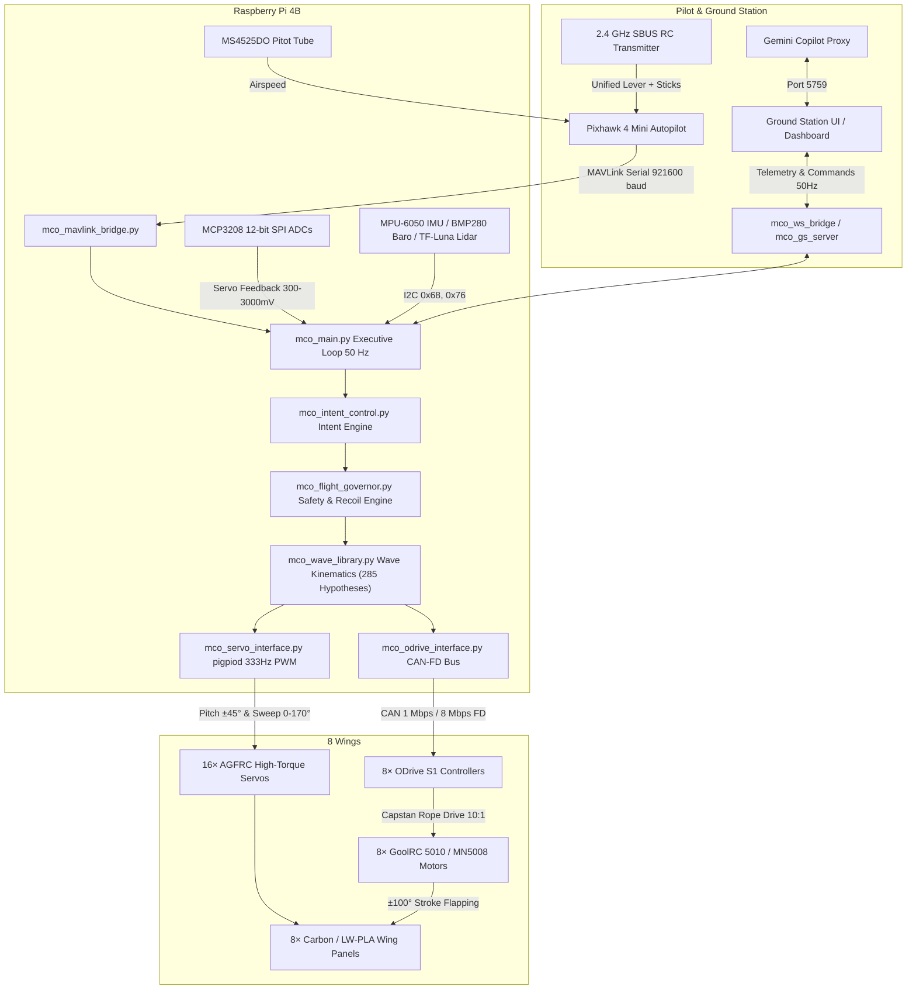

# MCO-1D Metachronal Cascade Ornithopter

[](https://github.com/wrbell/dad-ornithopter/actions/workflows/ci.yml)
[](https://www.python.org/downloads/)
[](LICENSE)
[](docs/mark1/MCO-1D_Mark1_Software_Reference.md)
[](cad/print_package_wing_root/README_3D_PRINT_GUIDE.md)

**Autonomous 8-Wing Bio-Inspired Technology Demonstrator**  
*Flight Software, Parametric CAD, Additive Manufacturing & Kinematic Control Repository*

Remote: [`https://github.com/wrbell/dad-ornithopter.git`](https://github.com/wrbell/dad-ornithopter.git)

---

## 1. System Overview

The **MCO-1D** is an advanced unmanned aerial technology demonstrator employing four cascade-arranged wing pairs (8 independent wings: $W_1$ to $W_4$, Port & Starboard) executing a synchronized metachronal flapping wave — sequential phase offsets analogous to crustacean and insect propulsion. 

Designed as the sub-scale flight test validator for the crewed **MCO-1A Search-and-Rescue** aircraft, MCO-1D replaces traditional rotary or fixed-wing flight with continuous lift-and-thrust wave kinematics, variable wing sweep ($0^\circ$ to $170^\circ$), dynamic pitch morphing ($\pm 45^\circ$), and an intent-driven flight control architecture.



---

## 2. Technical Specifications & Performance Baseline

| Parameter | Value / Specification | Notes / Governing Document |
| :--- | :--- | :--- |
| **Designation** | MCO-1D Drone Prototype | Flight Test Demonstrator for MCO-1A |
| **Operational MTOW** | 5.367 kg (5,367 g) baseline | GoolRC 5010-14 360KV + 6S LiPo; balanced at 26.5% MAC |
| **Primary Flight Regime** | STOL Forward-Flight SAR (`H-SAR-FF`) | Catapult/runway launch; hover as bench characterization gate |
| **Wing Configuration** | 4 cascade pairs (8 wings) | Longitudinal stagger: 138 mm between roots |
| **Airfoils** | UIUC S1223 ($C_{L,\max} = 2.40$) & SD7062 | S1223 high-lift baseline / SD7062 high-speed sprint option |
| **Semi-Spans (Root to Tip)** | $W_1$: 772 mm, $W_2$: 749 mm, $W_3$: 735 mm, $W_4$: 712 mm | Rev 20 / Addendum R21 specification |
| **Flap Stroke Amplitude** | $\pm 100^\circ$ ($200^\circ$ circular sector arc) | Full stroke authority at $f \le 2.2\text{ Hz}$, smootherstep profile |
| **Flap Frequency Ceiling** | 3.5 Hz | Capstan 10:1 reduction, ODrive `vel_limit \ge 150` rad/s |
| **Pitch Authority** | $\pm 45^\circ$ continuous dynamic AoA | Driven via AGFRC servos and differential bevel wrist |
| **Sweep Authority** | $0^\circ$ (full forward) to $170^\circ$ (stowed) | Programmed via AGF-SPV3 programmer |
| **Design Cruise Speed** | 9.0 m/s (17.5 kt) | Clean metachronal cascade ($L > 34\text{ N}$) |
| **Sprint Speed** | 14.0 m/s (27.0 kt) | Forward swept dart configuration |
| **Stall Speed ($V_s$)** | ~6.2 m/s at 5.37 kg MTOW | Dynamic stall protection in [`mco_intent_control.py`](firmware/mco_intent_control.py) |
| **Flap Motors** | 8× GoolRC 5010-14 360KV BLDC | 2.2 N·m peak torque, EZO high-load bearings |
| **Main Propulsion Battery** | 6S LiPo 5000 mAh (22.2V nominal) | Quick-pin sliding tray (230–340 mm arm along keel) |
| **Servo Power Bus** | 2S LiPo 3000 mAh 45C (7.4V) | Isolated from motor bus; 16-port PDB + 4,700 µF capacitor |
| **CAN Interface** | Waveshare MCP2518FD Hat | 1 Mbps nominal / 8 Mbps data CAN-FD |

---

## 3. V10 Wing Root Mechanism & Parametric CAD

The wing root actuation mechanism is a high-precision robotic assembly combining a 10:1 capstan reduction flapping shoulder with a 2-DOF differential bevel wrist cartridge:

```
Wing Root Drivetrain (1 of 8):
  [GoolRC 5010 BLDC] 
       │ (Ø4mm D-flat shaft)
       ▼
  [05 Stepped Capstan Pinion] (10:1 reduction)
       │ (Dyneema SK99 0.8mm dual lines)
       ▼
  [04 Stagecoach Sector Drum] (210° arc, dual helical V-grooves, internal tunnels)
       │ (Ø10mm Ti dead-axle, 6800RS bearings)
       ▼
  [06 Differential Gimbal Yoke] + [07/08 Bevel Gearset] (Pitch ±45° / Sweep 0-170°)
       │
       ▼
  [Ø10mm Carbon Wing Spar Socket]
```

### Key Mechanical Innovations:
- **01 Bilateral Fuselage Collar**: Clamps directly to the Ø20mm continuous carbon spine tube, mounting both port and starboard wing root stands.
- **02 Powertrain Stand & 03 Top Brace**: Dual-shear bridge capturing the motor shaft, capstan pinion top journal, and drum dead axle.
- **04 Stagecoach Sector Drum (V10)**: Lightweight 7-spoke truss drum ($34.15\text{ g}$) featuring dual parallel helical V-groove tracks, tangential Dyneema line tunnels, and recessed M3 retention clamp counterbores.
- **06–08 2-DOF Differential Bevel Wrist**: Independent pitch morphing and wing sweep folding with field-swappable quickswap bevel gears.
- **Zero Pairwise Interference**: Audited across all 36 solid contact pairs in [`scratch/assemble_wing_root.py`](file:///Users/drbell/.gemini/antigravity/brain/8527ddfb-5cfb-4a05-9500-af801728038e/scratch/assemble_wing_root.py) = **`0.0000 mm³`**.
- **Autodesk Fusion 360 Archive**: Fully rigged multi-component assembly with 19 components and 18 As-Built joints in [`cad/manufactured/MCO-1D_V10_Wing_Root_Assembly.f3d`](cad/manufactured/MCO-1D_V10_Wing_Root_Assembly.f3d).
- **Master STEP Delivery**: Authoritative 9-solid STEP assembly in [`cad/manufactured/v10_complete_wing_root_assembly.step`](cad/manufactured/v10_complete_wing_root_assembly.step).

---

## 4. 3D Print Package & Slicing Specifications

All 3D printable parts are validated for production on the **Prusa CORE One** (or Bambu Lab X1C / Voron 2.4 / Prusa MK4 with $\ge 220 \times 220\text{ mm}$ bed).

| Part Name | Recommended Profile | Perimeters / Infill | Mass (g) | Material |
| :--- | :--- | :---: | :---: | :--- |
| `01_v10_bilateral_fuselage_collar` | `pa12cf_structural` | 6 walls, 60% Gyroid | 69.5 g | PA12-CF Carbon Nylon |
| `02_v10_powertrain_stand` | `pa12cf_structural` | 6 walls, 60% Gyroid | 36.0 g | PA12-CF Carbon Nylon |
| `03_v10_dual_shear_top_brace` | `pa12cf_solid_gears` | 6 walls, 100% Solid | 5.8 g | PA12-CF Carbon Nylon |
| `04_v10_stagecoach_sector_drum` | `pa12cf_structural` | 4 walls, 35% Gyroid | 34.2 g | PA12-CF Carbon Nylon |
| `05_v10_stepped_capstan_pinion` | `pa12cf_solid_gears` | 6 walls, 100% Solid | 1.8 g | PA12-CF Carbon Nylon |
| `06_v9_differential_gimbal_yoke` | `pa12cf_solid_gears` | 6 walls, 100% Solid | 3.1 g | PA12-CF Carbon Nylon |
| `07_v9_quickswap_bevel_gear_pair_x2` | `pa12cf_solid_gears` | 6 walls, 100% Solid | 3.0 g | PA12-CF Carbon Nylon |
| `08_v9_quickswap_bevel_spider_output` | `pa12cf_solid_gears` | 6 walls, 100% Solid | 1.5 g | PA12-CF Carbon Nylon |
| **`PLATE_01_PA12CF_ALL_STRUCTURAL_PARTS`** | **`pa12cf_structural`** | **Single-bed layout** | **~154 g** | **PA12-CF (fits 220×220mm)** |

Print Guide & Slicing Documentation: [`cad/print_package_wing_root/README_3D_PRINT_GUIDE.md`](cad/print_package_wing_root/README_3D_PRINT_GUIDE.md).

---

## 5. Unified Pilot Control Architecture

The MCO-1D introduces an **Intent Control Layer** mapping a single physical lever on the pilot's transmitter (CH3) across all flight regimes:

| Lever Range | Flight Regime | Aerodynamic State & Wing Kinematics |
| :---: | :--- | :--- |
| **88% – 100%** | **Sprint / Max Thrust** | Wings swept forward ($30^\circ$), reduced stroke amplitude, peak frequency ($3.5\text{ Hz}$). CF-1 clap burst below 10 m/s (`H-91`). Peak forward thrust. |
| **78% – 88%** | **High Thrust / Climb** | Steep climb envelope (`H-92`, `H-71`), metachronal cascade, high specific excess power ($P_s > 0$). |
| **68% – 78%** | **Powered Cruise** | Fast transit, clean metachronal cascade ($90^\circ$ inter-pair phase lag, `H-86`, `H-104`), rapid ground coverage. |
| **55% – 68%** | **Economy Cruise** | Optimized Strouhal number ($St \approx 0.30$), minimum energy per km ($P_s = 0$, `H-94`, `H-107`, `H-49`). |
| **45% – 55%** | **Trim Detent** | **Dual Altitude Equilibrium**: Level cruise in fixed-wing ($P_s = 0$); stationary hover hold in helicopter mode ($0\text{ fpm}$). |
| **28% – 45%** | **Glide & Soar** | Flapping frequency throttled ($0.5\text{--}1.5\text{ Hz}$) or thermal soaring lock (`H-102`, `H-90`, `H-LSB-1`). |
| **16% – 28%** | **Pigeon Descent** | High-dihedral V-shape ($+40^\circ$ to $+60^\circ$), steep glide slope without airspeed buildup. In hover: landing flare. |
| **6% – 16%** | **Active Brake** | Active upstroke negative AoA reverse thrust (`H-87`), turtle pivot brake (`H-103`), rapid deceleration. |
| **0% – 6%** | **Max Airbrake / Stop** | Full cascade reversal ($180^\circ$), maximum aerodynamic braking flare (`H-55`, `H-108`, `LB3_EMERG`), motor idle/stop. |

---

## 6. Developer Workflow & CLI (`./mco`)

The project uses `./mco` as its unified operational entrypoint:

```bash
# 1. Repository Hygiene, Markdown Link & CAD/Slicer Health Check
./mco doctor                  # or: make doctor

# 2. Automated Test Suite (1,020 Tests) & Bench Qualification
./mco test                    # Full test suite (or: make test)
./mco test --suite prusaslicer # Targeted test suite
./mco test --tc01             # TC-01 rigid bench qualification

# 3. 50 Hz Hardware-in-the-Loop SITL Flight Simulation
./mco sim                     # Run 50 Hz simulation (or: ./run_sim.sh)

# 4. Bill of Materials (BOM) & Mass Budget Audit
./mco bom --view              # Refresh & inspect terminal BOM summary
./mco bom --json              # Output machine-readable JSON mass breakdown

# 5. Parametric CAD Generation & Mesh Manifold Verification
./mco cad verify              # Audit all print package STLs (manifold & bed fit)
./mco cad package             # Regenerate Wing Root CDR 3D print package

# 6. Model Slicing & G-Code Inspection via PrusaSlicer MCP
./mco slice <model.stl> --inspect
./mco slice <model.stl> --profile pa12cf_structural
./mco slice <model.stl> --profile pa12cf_solid_gears --gui

# 7. Documentation & PDF Manual Generation
./mco docs all                # Regenerate all 5 publication-grade assembly guides
```

Full contributor guide and pull request rules: [`CONTRIBUTING.md`](CONTRIBUTING.md).

---

## 7. Repository Layout

```
dad-ornithopter/
├── README.md                      # Mission Control & engineering overview
├── CONTRIBUTING.md                # Contributor guide & git workflow gates
├── AGENTS.md                      # Agent rules, repo layout contract & workflow gates
├── INDEX.md                       # Comprehensive 10-domain master file catalog
├── PROJECT_STATE.md               # Real-time build state, firmware revisions, open items
├── mco                            # Unified engineering CLI (doctor, test, sim, cad, slice, bom, docs)
├── Makefile                       # Standard make targets delegating to ./mco
├── view_bom.sh                    # Live BOM pricing & MTOW auto-updater / inspector
├── run_sim.sh                     # Launch simulation mode in one command
├── start_gs.sh                    # Launch Ground Station & telemetry bridge
│
├── .github/                       # Continuous integration workflows
│   └── workflows/ci.yml           # Automated GitHub Actions test & doctor pipeline
│
├── docs/mark1/                    # MCO-1D Mark 1 Authoritative Engineering Suite & PDFs
│   ├── MCO-1D_Mark1_Master_Specification.md
│   ├── MCO-1D_Mark1_Bill_of_Materials.md
│   ├── MCO-1D_Mark1_Manufacturing_Guide.md
│   ├── MCO-1D_Mark1_Commissioning_Manual.md
│   ├── MCO-1D_Mark1_Operator_Manual.md
│   ├── MCO-1D_Mark1_Flight_Test_Protocol.md
│   ├── MCO-1D_Mark1_Software_Reference.md
│   ├── MCO-1D_Hierarchical_Exploded_Installation_Guide.pdf
│   ├── MCO-1D_V10_Powertrain_Mount_Installation_Guide.pdf
│   └── MCO-1D_V10_Stagecoach_Wrist_Assembly_Guide.pdf
│
├── firmware/                      # Active flight software (50 Hz executive & 285 hypotheses)
│   ├── mco_main.py                # Flight computer executive loop (50 Hz)
│   ├── mco_wave_library.py        # Authoritative kinematics library (285 hypotheses)
│   ├── mco_flight_governor.py     # Deterministic safety governor, WIG floor & Recoil Engine
│   └── mco_intent_control.py      # Unified lever & 3-layer intent arbitration
│
├── cad/                           # Parametric 3D models, print packages & slicer profiles
│   ├── print_package_wing_root/   # CDR 3D print package (01–08 + PLATE_01 + Build Guide)
│   ├── slicer_profiles/           # PrusaSlicer 2.9.6 .ini profiles (PA12-CF, LW-PLA, PLA)
│   ├── drawings/                  # Rib profiles, wing construction, fuselage schematics
│   └── manufactured/              # Active STEP/STL/3MF/F3D deliverables
│
├── scripts/                       # Tooling, MCP servers, CAD/PDF generators & audits
│   ├── mco_cli.py                 # Unified CLI backing ./mco and Makefile
│   ├── mco_bom_tool.py            # Zero-dependency live BOM pricing & mass engine
│   ├── run_tc01_bench_checkout.py # Automated laboratory bench qualification runner (TC-01)
│   ├── mcp/                       # PrusaSlicer 2.9.6 FastMCP server (prusaslicer_mcp_server.py)
│   ├── cad/                       # Active build123d / CadQuery parametric CAD generators
│   ├── docs/                      # ReportLab PDF manual & worksheet generators
│   └── audits/                    # CFD, FEA, and full-envelope mission simulation scripts
│
├── tests/                         # 1,020 automated unit & aerodynamic verification tests
└── ui/                            # Ground station dashboards & 3D wing visualizers
```

---

## 8. Applicable Aviation Standards
- **DO-178C**: Software Considerations in Airborne Systems and Equipment Certification
- **DO-160G**: Environmental Conditions and Test Procedures for Airborne Equipment
- **MIL-STD-1797B**: Flying Qualities of Piloted Aircraft
- **FAA-H-8083-1B / 25B**: Aircraft Weight and Balance / Pilot's Handbook of Aeronautical Knowledge
