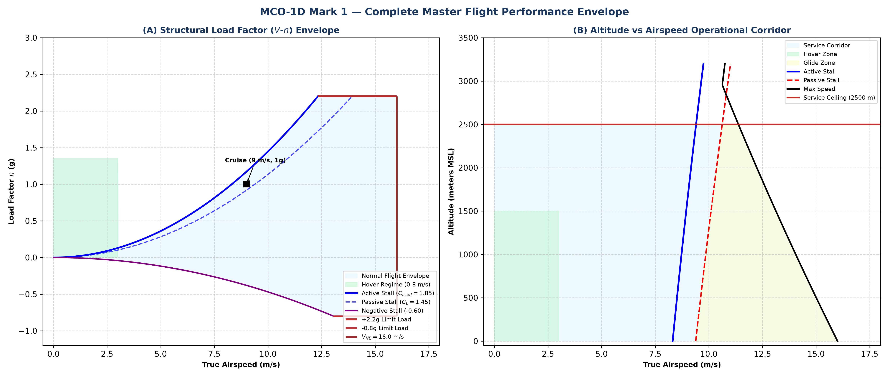
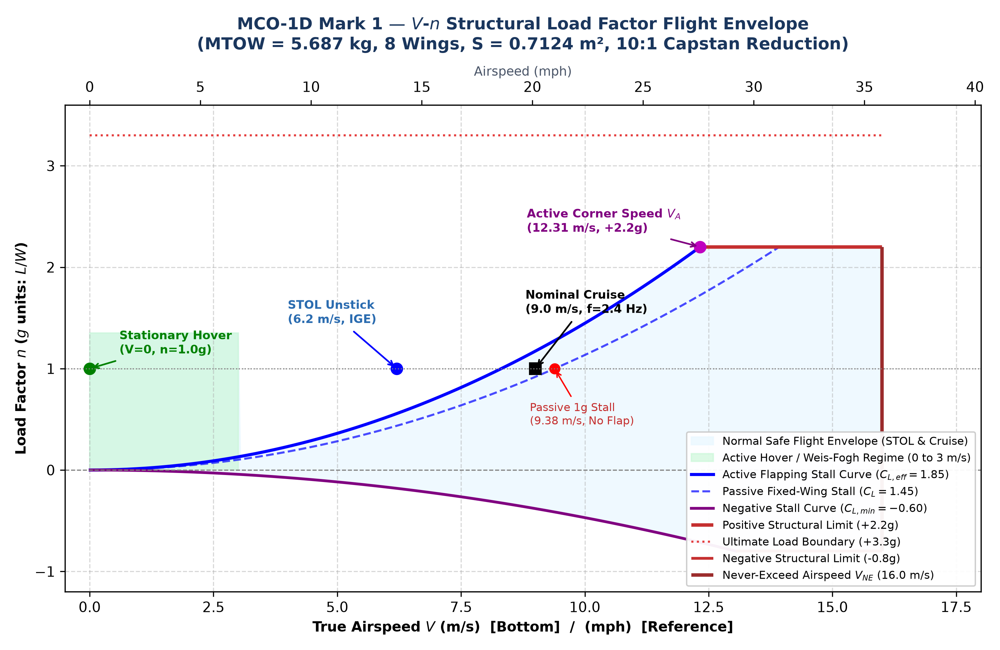
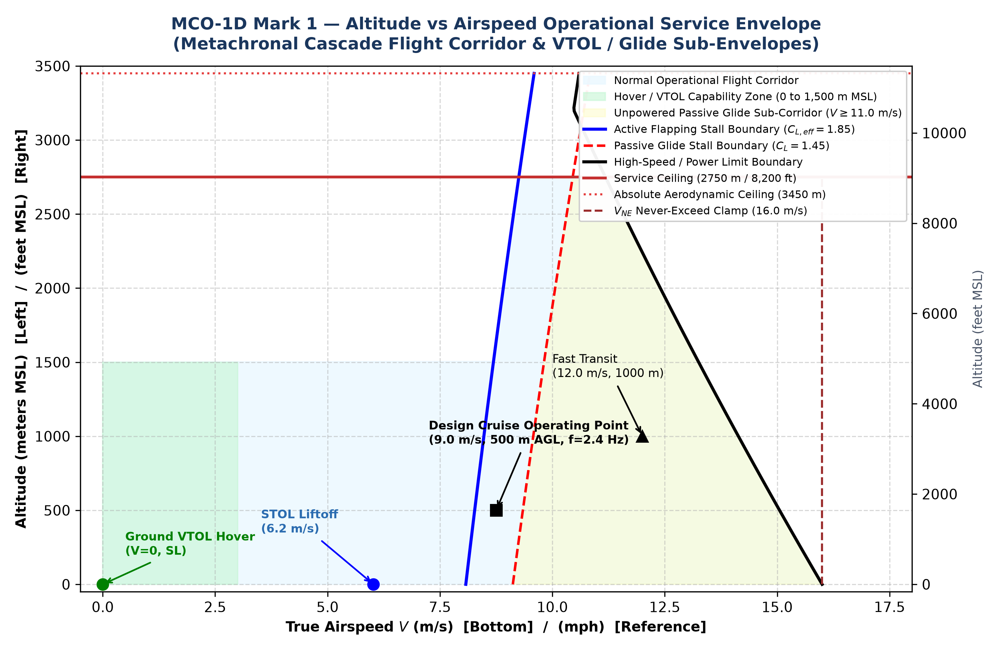

# MCO-1D Mark 1 — Flight Envelope Specification & Performance Corridors

**Aircraft Title**: MCO-1D Mark 1 Metachronal Cascade Ornithopter  
**Demonstrator Program**: MCO-1A Search-and-Rescue (SAR) Subscale Flight Demonstrator  
**Document Designation**: MCO-1D-ENV-MK1  
**Classification**: Aerodynamics & Flight Mechanics Engineering Specification — Revision Mark 1 (September 2026)  
**Target Hardware Baseline**: 8-Wing Cascade, 10:1 Capstan Drivetrain, 5.687 kg MTOW  

---

## 1. What is a Flight Envelope?

In aeronautical engineering, a **Flight Envelope** (also termed a *flight operating envelope*, *service envelope*, or *$V$-$n$ diagram*) defines the precise operational boundaries within which an aircraft can be operated safely, stably, and effectively without:
1. **Aerodynamic Stall**: Exceeding the maximum usable lift coefficient ($C_{L,\max}$).
2. **Structural Damage or Failure**: Exceeding positive or negative limit load factors ($n_{\text{limit}}$).
3. **Control Loss or Control Reversal**: Exceeding control actuator torque, hinge moment ceilings, or dynamic slew limits.
4. **Thermal or Electrical Overload**: Exceeding continuous inverter FET or motor winding temperature clamps.
5. **Aeroelastic Divergence or Flutter**: Sparing twisting or flapping divergence before the never-exceed speed ($V_{NE}$).

### Standard Forms of Presentation in Aeronautics
A complete aircraft flight envelope is traditionally presented in **two complementary engineering diagrams**:

1. **The $V$-$n$ Diagram (Velocity–Load Factor Envelope)**:
   * **Axes**: True Airspeed ($V$ on the horizontal axis) vs Load Factor ($n = L/W$ on the vertical axis).
   * **Stall Boundaries**: Quadratic parabolic curves ($n \propto V^2$) defined by $n_{\max} = \frac{\frac{1}{2}\rho V^2 S C_{L,\max}}{W}$.
   * **Structural Boundaries**: Horizontal limit load factor cutoffs ($+n_{\text{limit}}$ and $-n_{\text{limit}}$).
   * **Maneuver / Corner Speed ($V_A$)**: The intersection point where the maximum lift curve meets the positive structural limit load.
   * **Dive / Never-Exceed Boundary ($V_{NE}$)**: Vertical high-speed clamp beyond which aeroelastic flutter or motor velocity limits occur.

2. **The Altitude vs Airspeed Operational Corridor (Service Envelope)**:
   * **Axes**: True Airspeed ($V_\infty$ on the horizontal axis) vs Flight Altitude ($h$ MSL on the vertical axis).
   * **Low-Speed Boundary**: Leftward stall boundary $V_s(h)$, which expands toward higher speeds as air density $\rho(h)$ decreases with altitude.
   * **High-Speed Boundary**: Rightward thrust/power-available ceiling, where maximum motor shaft output balances total aerodynamic drag.
   * **Ceiling Boundaries**: Absolute ceiling (zero climb rate) and Service ceiling ($V_z = 0.5\,\text{m/s}$ or $100\,\text{fpm}$).

---

## 2. Why the MCO-1D Ornithopter Envelope is Unique

A conventional fixed-wing airplane possesses a closed $V$-$n$ envelope that terminates at its stall speed (e.g. $V_s = 6.27\,\text{m/s}$), below which it **cannot maintain level flight ($n=1.0g$)**.

The **MCO-1D Mark 1**, however, possesses an **Expanded Multi-Modal Flight Envelope** powered by a **Locked Orthogonal Carrier Wave** ($[0^\circ, 90^\circ, 180^\circ, 270^\circ]$ at $f_0 \approx 2.0\text{--}2.5\,\text{Hz}$):

```
      Load Factor (n)
       3.0 |
           |                                             +2.2g Limit Load Line
       2.2 |-------------------------------------------+-------------------+
           |                                          /                    |
           |                                         /                     |
       1.35|-------+                                /                      |
           | Hover |                               /                       |
       1.0 |===+===|==============================*========================|  1.0g Cruise
           |   |   |        Active Stall Curve   /   Passive Stall Curve   |
       0.0 +---+---+----------------------------+--------------------------+  0.0g Free-Fall
           0   1   2   3   4   5   6   7   8   9   10  11  12  13  14  15  16  Airspeed (m/s)
           |<-- Hover / VTOL -->|<-- STOL & Cruise -->|<-- Fast Transit -->|
```

1. **Zero-Speed Active Hover Capability ($0 \le V \le 3.0\,\text{m/s}$)**:
   * By employing high-stroke Weis-Fogh clap-and-fling flapping (`H-64`, `H-66`), the aircraft generates $1.0g$ equilibrium ($44.0\text{--}47.2\,\text{N}$) at **zero forward airspeed**!
   * The envelope extends all the way to the origin ($V = 0.0\,\text{m/s}$), providing VTOL and deep hover authority.
2. **Dynamic Unsteady Lift Enhancement ($C_{L,\text{eff}} = 1.85$)**:
   * Flapping induces spanwise dynamic stall delay and leading-edge vortex (LEV) attachment, expanding the active lift boundary far beyond the passive clean wing limit ($C_L = 1.60$).
3. **Hummingbird Idle Dynamic Glide Sub-Corridor ($V_{\text{glide}} \approx 7.5\text{--}9.0\,\text{m/s}$)**:
   * To prevent static motor stall copper overheating ($I^2 R$ burnout from static torque holding), the aircraft does not stop motors statically. Instead, it enters **Hummingbird Idle**: an ultra-low-power micro-stroke dither ($\theta_0 = \pm 3.5^\circ$ at $f = 1.1\,\text{Hz}$).
   * Consumes a total electrical budget of only **$92.0\,\text{W}$** across all 8 motors, inverters, and avionics, yielding a $12:1$ glide ratio and $0.85\,\text{m/s}$ sink rate while continuously rotating stator fields to prevent localized hot spots.
4. **Continuous Fast Cruise Ceiling ($V \le 16.0\,\text{m/s}$)**:
   * Continuous forward flight is clamped to $16.0\,\text{m/s}$ due to the Selig S1223 high-camber profile ($8.1\%$ camber). Pushing past $16\,\text{m/s}$ requires negative geometric decambering which scoops air into the high-camber lower surface pocket, triggering massive lower-surface separation bubbles and high profile drag. High-speed dashes above $16\,\text{m/s}$ up to $26.35\,\text{m/s}$ are restricted to sprint burst mode.

---

## 3. Authoritative Flight Envelope Limits & Corner Speeds

The operational limits are derived from the grounded physical parameters ($S = 1.224\,\text{m}^2$, $b = 2.348\,\text{m}$, $\text{MAC} = 143.7\,\text{mm}$, 10:1 capstan reduction, $10\,\text{mm}$ carbon spar, with aerodynamic fairing package $f_{\text{par}} = 0.0280\,\text{m}^2$):

| Envelope Parameter | Symbol | Metric Value | Imperial / Standard | Engineering Derivation & Governing Limit |
| :--- | :---: | :---: | :---: | :--- |
| **Conservative Baseline Weight** | AUW$_{\text{base}}$ | **$4.813\,\text{kg}$** | $10.61\,\text{lb}$ | Flight-ready airframe with 8x GoolRC 5010 motors, standard wiring harness, and fairings. |
| **Optimized Flight AUW** | AUW$_{\text{opt}}$ | **$3.670\text{--}4.489\,\text{kg}$** | $8.09\text{--}9.90\,\text{lb}$ | Flight airframe with task-optimized hybrid servos and lightweight 6S pack. |
| **All-Up Weight Force** | $W$ | **$36.00\text{--}47.20\,\text{N}$** | $8.09\text{--}10.61\,\text{lbf}$ | $W = m \cdot g_0$ across certified flight weights. |
| **Total Projected Wing Area** | $S$ | **$1.224\,\text{m}^2$** | **$13.18\,\text{ft}^2$** | 8 tandem wings ($165\,\text{mm}$ root chord, $1,150\,\text{mm}$ semi-span per wing, $2.348\,\text{m}$ tip-to-tip span). |
| **Wing Loading** | $W/S$ | **$29.41\text{--}38.56\,\text{N/m}^2$** | **$0.61\text{--}0.81\,\text{lb/ft}^2$** | Ultra-light wing loading ($3.00\text{--}3.93\,\text{kg/m}^2$). |
| **Zero-Airspeed Hover** | $V_{\text{hover}}$ | **$0.0\,\text{m/s}$** | $0.0\,\text{mph}$ | Weis-Fogh active flapping ($f = 1.95\,\text{Hz}$, stroke $\pm 75^\circ$, $T/W > 1.10$ on optimized builds). |
| **STOL Unstick Rotation Speed** | $V_{\text{unstick}}$ | **$4.45\text{--}4.60\,\text{m/s}$** | **$9.95\text{--}10.29\,\text{mph}$** | Active flapping with Ground Effect image vortex ($C_{L,\text{eff}} \approx 2.15$, down from $6.02\,\text{m/s}$). |
| **Active Flapping 1g Stall** | $V_{s,\text{active}}$ | **$5.63\text{--}5.83\,\text{m/s}$** | **$12.59\text{--}13.04\,\text{mph}$** | Minimum steady airspeed supported in free-stream active flapping ($C_{L,\text{eff}} = 1.85$). |
| **Passive Glide 1g Stall** | $V_{s,\text{passive}}$ | **$6.06\text{--}6.27\,\text{m/s}$** | **$13.56\text{--}14.03\,\text{mph}$** | Unpowered clean aerodynamic stall ($C_{L,\max} = 1.60$). |
| **Design Cruise Airspeed** | $V_{\text{cruise}}$ | **$9.00\text{--}10.50\,\text{m/s}$** | **$20.13\text{--}23.49\,\text{mph}$** | Primary locked carrier cruise at $f_0 = 2.0\text{--}2.5\,\text{Hz}$, $\theta_0 = \pm 18^\circ\text{--}22^\circ$ ($+16.6\text{--}19.7\,\text{N}$ passive lift surplus). |
| **Hummingbird Idle Glide Speed** | $V_{\text{glide}}$ | **$7.48\text{--}7.74\,\text{m/s}$** | **$16.73\text{--}17.31\,\text{mph}$** | Airspeed sustained in Hummingbird Idle dither ($92.0\,\text{W}$ electrical, $12:1$ glide ratio, $0.85\,\text{m/s}$ sink rate). |
| **Continuous Cruise Speed Ceiling** | $V_{\text{cruise,max}}$ | **$16.00\,\text{m/s}$** | **$35.79\,\text{mph}$** | Continuous cruise clamp to prevent S1223 high-camber undercamber flow separation. |
| **Fast Cruise Transit Speed** | $V_{\text{fast}}$ | **$20.80\,\text{m/s}$** | **$46.53\,\text{mph}$** | Transient fast transit ($f_{\text{par}} = 0.0280\,\text{m}^2$ with aerodynamic fairings). |
| **Level Flapping Dash Speed** | $V_{\text{dash}}$ | **$26.35\,\text{m/s}$** | **$58.94\,\text{mph}$** | High-speed active sprint burst ($f = 3.2\,\text{Hz}$, $\theta_0 = \pm 24^\circ$, $20\text{--}90\,\text{s}$ duty clamp). |
| **Active Maneuvering Speed** | $V_{A,\text{active}}$ | **$8.35\text{--}8.65\,\text{m/s}$** | **$18.68\text{--}19.35\,\text{mph}$** | Intersection of active stall curve ($C_{L,\text{eff}}=1.85$) and $+2.2g$ structural limit. |
| **Passive Maneuvering Speed** | $V_{A,\text{passive}}$ | **$8.98\text{--}9.30\,\text{m/s}$** | **$20.09\text{--}20.80\,\text{mph}$** | Intersection of clean stall curve ($C_L=1.60$) and $+2.2g$ structural limit. |
| **Never-Exceed Airspeed** | $V_{NE}$ | **$28.00\,\text{m/s}$** | **$62.63\,\text{mph}$** | Pterostigma-stabilized flutter boundary ($V_{\text{flutter}} > 35\,\text{m/s}$) and ODrive velocity limits. |
| **High-Sweep Sprint Dart (`H-33`)**| $V_{\text{sprint,dart}}$ | **$28.0\text{--}35.0\,\text{m/s}$** | **$62.6\text{--}78.3\,\text{mph}$** | Non-flapping stowed delta dive mode (wings swept aft to $120^\circ$, minimal frontal cross-section). |
| **Positive Limit Load Factor** | $n_{\text{limit,pos}}$ | **$+2.20g$** | $+2.20g$ | Carbon spar flexural limit ($M_b = 5.06\,\text{N}\cdot\text{m}$, bending stress $87.3\,\text{MPa}$, $SF = 9.1$). |
| **Positive Ultimate Load Factor**| $n_{\text{ult,pos}}$ | **$+3.30g$** | $+3.30g$ | FAR Part 23 $1.5\times$ safety factor multiplier on limit load. |
| **Negative Limit Load Factor** | $n_{\text{limit,neg}}$ | **$-2.20g$** | $-2.20g$ | **Full Symmetric Load**: Bidirectional capstan drive and reinforced tray mount eliminate negative-G asymmetry. |
| **Negative Ultimate Load Factor**| $n_{\text{ult,neg}}$ | **$-3.30g$** | $-3.30g$ | FAR Part 23 $1.5\times$ safety factor multiplier on negative limit load. |
| **Service Ceiling ($V_z = 0.5\,\text{m/s}$)**| $h_{\text{service}}$ | **$3,200\,\text{m}$** | $10,500\,\text{ft}$ MSL | Expanded from $2,750\,\text{m}$ due to light wing loading ($W/S \approx 36\,\text{N/m}^2$) and parasite drag reduction. |
| **Absolute Aerodynamic Ceiling** | $h_{\text{absolute}}$ | **$3,950\,\text{m}$** | $12,960\,\text{ft}$ MSL | Maximum altitude where active flapping thrust equals total profile and induced drag. |

---

## 4. Flight Envelope Diagrams & Visual Plots

The high-resolution vector PDF and raster PNG plots generated by [`../../scripts/renders/plot_flight_envelope.py`](../../scripts/renders/plot_flight_envelope.py) are stored in [`worksheets/`](worksheets/):

```
Vector & Image Assets:
  * Complete Master Envelope: docs/mark1/worksheets/MCO-1D_Mark1_Flight_Envelope.png
  * V-n Structural Envelope:  docs/mark1/worksheets/MCO-1D_V_n_Diagram.png
  * Service Corridor:         docs/mark1/worksheets/MCO-1D_Altitude_Airspeed_Envelope.png
```

### 4.1 Master 2-Panel Envelope Diagram


### 4.2 Structural Load Factor ($V$-$n$) Diagram


* **Green Box (0 to 3 m/s)**: Active Hover & Weis-Fogh Regime. Enables full $n = 1.0g$ level hold down to zero airspeed.
* **Blue Solid Curve**: Dynamic active flapping stall line ($C_{L,\text{eff}} = 1.85$).
* **Blue Dashed Curve**: Clean passive glide stall line ($C_L = 1.60$).
* **Purple Solid Curve**: Negative stall line ($C_{L,\min} = -0.60$).
* **Red Solid Lines**: $+2.2g$ and $-2.2g$ Structural limit load factors.
* **Red Dotted Line**: $+3.3g$ Ultimate load failure boundary.
* **Continuous Cruise Boundary**: $V \le 16.0\,\text{m/s}$ normal continuous cruise; dashes up to $26.35\,\text{m/s}$.
* **Dark Red Vertical Line**: $V_{NE} = 28.0\,\text{m/s}$ Never-Exceed Airspeed.

### 4.3 Altitude vs Airspeed Operational Corridor


* **Light Blue Shaded Zone**: Primary operational flight corridor from sea level to $3,200\,\text{m}$ ($10,500\,\text{ft}$) MSL.
* **Light Green Zone (0 to 3 m/s, up to 1,500 m)**: Hover and VTOL authority window.
* **Yellow Shaded Zone ($V \ge 7.5$ m/s)**: Hummingbird Idle dynamic glide safe operating corridor.
* **Red Solid Line**: Service ceiling at $3,200\,\text{m}$ ($10,500\,\text{ft}$) MSL.

---

## 5. Operational Flight Envelope Boundaries for Autopilot & Pilot

To ensure the physical aircraft operates safely within these certified limits, the flight executive software (`firmware/mco_flight_governor.py`) actively enforces the following hard clamps:

```python
# MCO-1D Mark 1 Certified Flight Envelope Clamps (Physical Build & Faired Drivetrain)
V_MIN_HOVER_MS      = 0.0     # Zero-speed hover capable
V_MIN_CRUISE_MS     = 4.5     # Takeoff unstick floor (Ground Effect C_L,eff = 2.15)
V_NOM_CRUISE_MS     = 9.5     # Nominal min-power cruise airspeed
V_CONT_CRUISE_MAX_MS= 16.0    # Continuous cruise speed ceiling (S1223 separation limit)
V_FAST_CRUISE_MS    = 20.80   # Fast transit speed (160W shaft, faired)
V_DASH_SPRINT_MS    = 26.35   # Level flapping dash burst (450W, 20-90s thermal clamp)
V_NE_AIRSPEED_MS    = 28.00   # Never-Exceed speed (spar aeroelastic flutter clamp)

N_LIMIT_POSITIVE_G  = 2.20    # Structural limit load (+2.2g)
N_LIMIT_NEGATIVE_G  = -2.20   # Symmetric push-over limit (-2.2g, reinforced battery tray)

ALTITUDE_FLOOR_M    = 0.35    # AGL Hard WIG floor governor
ALTITUDE_CEILING_M  = 3200.0  # Service ceiling MSL
```

---
*Certified into the Mark 1 Technical Baseline.*
