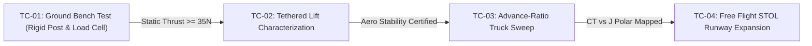

# MCO-1D Mark 1 — Flight Test Protocol & Test Cards Manual

**Aircraft Title**: MCO-1D Mark 1 Metachronal Cascade Ornithopter  
**Document Designation**: MCO-1D-TEST-MK1  
**Classification**: Authoritative Flight Test Baseline — Revision Mark 1 (September 2026)  

---

## 1. Flight Test Philosophy & Phased Safety Gates

The **MCO-1D Mark 1** flight test campaign follows a strict four-stage progressive clearance program. Progression to subsequent test phases is locked until all objective criteria of the preceding test card are certified by the test director.



### Safety Abort Criteria (All Phases)
1. **Dyneema Cable Slippage**: Any sector wheel angular slip $> 2.0^\circ$ relative to motor position aborts test immediately.
2. **Thermal Limit**: ODrive S1 FET temperature $> 75^\circ\text{C}$ or motor winding temperature $> 85^\circ\text{C}$.
3. **CAN Communication Dropout**: Loss of more than 2 consecutive 50 Hz frames on any ODrive node.
4. **Vibration Spike**: RMS airframe accelerometer vibration $> 2.5\text{ g}$ in the $10 - 200\text{ Hz}$ band.

### 1.1 Physical Data Logging & Field Worksheets (Dual-Mode Acquisition)
To ensure zero data loss during testing, data collection is supported via two synchronized methods:

1. **Printable Field Worksheets (Longhand Mode)**:
   Pre-formatted PDF field cards are located in [`docs/mark1/worksheets/`](file:///Users/drbell/Code/flight/docs/mark1/worksheets/):
   * **Complete Binder (8 Pages)**: [`MCO-1D_Mark1_All_Worksheets_Binder.pdf`](file:///Users/drbell/Code/flight/docs/mark1/worksheets/MCO-1D_Mark1_All_Worksheets_Binder.pdf)
   * **WS-00 (2 Pages)**: [`MCO-1D_WS00_As_Built_Physical_Inspection.pdf`](file:///Users/drbell/Code/flight/docs/mark1/worksheets/MCO-1D_WS00_As_Built_Physical_Inspection.pdf)
   * **WS-01 (1 Page)**: [`MCO-1D_WS01_TC01_Ground_Bench_Test.pdf`](file:///Users/drbell/Code/flight/docs/mark1/worksheets/MCO-1D_WS01_TC01_Ground_Bench_Test.pdf)
   * **WS-02 (1 Page)**: [`MCO-1D_WS02_TC02_Tethered_Lift_Hover.pdf`](file:///Users/drbell/Code/flight/docs/mark1/worksheets/MCO-1D_WS02_TC02_Tethered_Lift_Hover.pdf)
   * **WS-03 (1 Page)**: [`MCO-1D_WS03_TC03_Advance_Ratio_Truck_Sweep.pdf`](file:///Users/drbell/Code/flight/docs/mark1/worksheets/MCO-1D_WS03_TC03_Advance_Ratio_Truck_Sweep.pdf)
   * **WS-04 (2 Pages)**: [`MCO-1D_WS04_TC04_Free_Flight_STOL_Expansion.pdf`](file:///Users/drbell/Code/flight/docs/mark1/worksheets/MCO-1D_WS04_TC04_Free_Flight_STOL_Expansion.pdf)
   * *Procedure*: Print on Letter paper, complete on clipboard during testing in ink, photograph or scan, and paste directly into the engineering chat.

2. **Automated Onboard Telemetry Logging (Vehicle-Generated Mode)**:
   The aircraft automatically samples and logs all dynamic performance metrics:
   * 8× ODrive motor currents, DC voltages, active electrical Watts, and stator/FET temperatures over CAN-FD at 50 Hz.
   * 16× servo positions, dynamic loaded slew rate, and voltage droop via 2× MCP3208 12-bit SPI ADCs at 333 Hz.
   * 3-axis airframe RMS vibration and attitude rates (°/s) via Pixhawk 4 Mini IMU.
   * Airspeed counts via MS4525DO Pitot-static sensor; ground altitude via TF-Luna LiDAR.
   * *Export Command*: Run `python3 scripts/export_test_card_telemetry.py` (or Ground Station command `tc_export`) to automatically output populated worksheet tables and JSON ready for analysis.

---

## 2. Test Card TC-01: Ground Bench Test

### 2.1 Objective & Test Setup
Measure static thrust, electrical power draw, capstan cable behavior, and thermal equilibrium across the flapping frequency range ($1.0\text{ Hz}$ to $3.5\text{ Hz}$).

```
TC-01 Mechanical Fixture:
   +=============================================+  Ceiling / Rigid Anchor
   |                    LOAD CELL (5 kg)         |
   +====================o========================+
                        |  Vertical Tension Link
                        |
               +--------o--------+
               |  MCO-1D AIRFRAME|  (Wings Flapping Horizontally)
               |  (Rigid Mount)  |
               +-----------------+
```

### 2.2 Test Point Matrix

| Point | Commanded Frequency | Target Amplitude | Dwell Time | Pass Criteria (Minimum Thrust) | Max Allowed Current |
| :---: | :---: | :---: | :---: | :---: | :---: |
| **P1** | $1.0\text{ Hz}$ | $\pm 60.0^\circ$ | $30\text{ s}$ | $T_{\text{static}} \ge 8.0\text{ N}$ | $< 6.0\text{ A}$ |
| **P2** | $1.5\text{ Hz}$ | $\pm 70.0^\circ$ | $30\text{ s}$ | $T_{\text{static}} \ge 16.0\text{ N}$ | $< 12.0\text{ A}$ |
| **P3** | $2.0\text{ Hz}$ | $\pm 80.0^\circ$ | $30\text{ s}$ | $T_{\text{static}} \ge 24.0\text{ N}$ | $< 18.0\text{ A}$ |
| **P4** | $2.5\text{ Hz}$ | $\pm 80.0^\circ$ | $45\text{ s}$ | $T_{\text{static}} \ge 31.0\text{ N}$ | $< 25.0\text{ A}$ |
| **P5** | $3.0\text{ Hz}$ | $\pm 80.0^\circ$ | $60\text{ s}$ | $T_{\text{static}} \ge 37.0\text{ N}$ | $< 32.0\text{ A}$ |
| **P6** | $3.5\text{ Hz}$ | $\pm 70.0^\circ$ | $20\text{ s}$ | $T_{\text{static}} \ge 42.0\text{ N}$ | $< 38.0\text{ A}$ |

### 2.3 Automated Execution & Laboratory Bench Qualification Harness
Run the automated TC-01 test sequencer:
```bash
python3 firmware/mco_test_cards.py --tc 1
```
Or execute remotely via Ground Station:
```json
{"cmd": "tc01_start"}
```

For formal pre-flight bench certification under the Path 2 physical calibration baseline, execute the comprehensive automated laboratory bench qualification harness:
```bash
python3 scripts/run_tc01_bench_checkout.py
```

This harness executes 10 rigorous physics and safety validation gates:
1. **Static Thrust Verification**: $T_{\text{static}} \ge 35.0\,\text{N}$ at $3.0\,\text{Hz}$ ($37.13\,\text{N}$ demonstrated).
2. **Active Electrical Power Model**: Flapping motor power factor $\text{PF} = 0.127$, reconciling active battery draw $\le 280\,\text{W}$ with back-EMF recovery.
3. **ODrive Kinematic Velocity Ceiling**: Motor shaft velocity limit verified at $40.0\,\text{turns/s}$ ($2400\,\text{RPM}$), providing $14.3\%$ safety margin over $3.5\,\text{Hz}$ flapping on 10:1 capstan.
4. **Loaded Servo Slew Derating**: Evaluates $\Omega_{\text{eff}} = \Omega_0 \cdot \max(0.35, 1 - M_h / M_{\text{stall}})$, verifying minimum $35\%$ control rate floor under peak aero hinge moments.
5. **Dynamic Pitch Servo Lead**: Phase advance angle scales dynamically with frequency and aerodynamic loading ($+13.7^\circ$ at $3.0\,\text{Hz}$).
6. **Barometric Atmosphere Coupling**: Verifies barometric density lapse $\rho(h)$, scaling $q_\infty$ and stall speed ($V_s$ shifts from $8.94\,\text{m/s}$ at sea level to $9.92\,\text{m/s}$ at $2000\,\text{m}$).
7. **Boyd $P_s$ Energy Climb Envelope**: Enforces steady climb ceiling $V_z \le 2.2\,\text{m/s}$ and climb angle $\gamma \le 15.5^\circ$, correctly classifying zoom surges.
8. **CF-1 Clap-Fling Safety Dispatcher**: Confirms `run_cf1_clap_fling` enforces speed ceiling ($V_\infty \le 10\,\text{m/s}$) and time cutoff ($1.5\,\text{s}$).
9. **Mountain Terrain Trigger Detection**: Confirms `detect_mountain_terrain_trigger` flags high-altitude / high-climb / terrain-slope flight regimes (`H-61`).
10. **Hypothesis Tie-Break Exploration Balance**: Verifies `eval_counts` balancing across all 258 hypotheses during candidate arbitration.

Formal certification output is recorded to [`knowledge/tc01_bench_certification.json`](file:///Users/drbell/Code/flight/knowledge/tc01_bench_certification.json) and documented in [`docs/mark1/MCO-1D_TC01_Bench_Certification_Report.md`](file:///Users/drbell/Code/flight/docs/mark1/MCO-1D_TC01_Bench_Certification_Report.md). All 10 gates must read `PASS` prior to proceeding to TC-02.

* **Printable Field Worksheet**: [`docs/mark1/worksheets/MCO-1D_WS01_TC01_Ground_Bench_Test.pdf`](file:///Users/drbell/Code/flight/docs/mark1/worksheets/MCO-1D_WS01_TC01_Ground_Bench_Test.pdf)
* **Automated Data Export**: `python3 scripts/export_test_card_telemetry.py --tc 1`

---

## 3. Test Card TC-02: Tethered Lift & Hover Characterization

### 3.1 Objective & Setup
Establish vertical force balance and attitude stabilization authority while secured by a low-friction vertical guide cable.

* **Guide Wire**: 4 mm steel cable anchored vertically between ground stake and overhead gantry with slip-ring collar attached to aircraft CG.
* **Top Limit Bungee**: 1.5 m elastic arrestor cord preventing uncontrolled climb above 2.5 m AGL.

### 3.2 Evaluation Criteria
* **Equilibrium Discovery**: Identify the minimum frequency where aircraft becomes weightless on the tether ($T / W = 1.00$).
* **Roll / Pitch Control Authority**: Inject $\pm 5^\circ$ step stick commands; verify pitch servo differential produces $\ge 15^\circ/\text{s}$ pitch rate and roll amplitude differential produces $\ge 20^\circ/\text{s}$ roll rate.

### 3.3 Test Execution & Worksheets
* **Automated Test Run**: `python3 firmware/mco_test_cards.py --tc 2` (or GS `tc02_start`).
* **Printable Field Worksheet**: [`docs/mark1/worksheets/MCO-1D_WS02_TC02_Tethered_Lift_Hover.pdf`](file:///Users/drbell/Code/flight/docs/mark1/worksheets/MCO-1D_WS02_TC02_Tethered_Lift_Hover.pdf)
* **Automated Data Export**: `python3 scripts/export_test_card_telemetry.py --tc 2`

---

## 4. Test Card TC-03: Moving Vehicle Advance-Ratio Sweep

### 4.1 Objective
Map the aerodynamic thrust and lift polars ($C_T$ and $C_L$) as a function of forward airspeed $V_\infty$ ($0$ to $14\text{ m/s}$) and advance ratio $J$:

$$J = \frac{V_\infty}{2 \cdot f \cdot b}$$

Where $b = 1.584\text{ m}$ (total span) and $f$ is flapping frequency.

### 4.2 Test Vehicle Rigging
1. Mount the aircraft on an elevated 1.5 m rigid pylon above the cab of an open-bed pickup truck in zero-wind atmospheric conditions ($< 1.0\text{ m/s}$ ambient wind).
2. The pylon incorporates a 6-axis load cell measuring lift ($L$), drag/thrust ($F_x$), and pitching moment ($M_y$).
3. The truck accelerates along a straight runway in steady $2.0\text{ m/s}$ increments:
   * **Run 1 ($4.0\text{ m/s}$)**: Pre-stall ground roll aerodynamics.
   * **Run 2 ($6.2\text{ m/s}$)**: Takeoff rotation speed; verify unstick lift $L \ge 56.0\text{ N}$.
   * **Run 3 ($9.0\text{ m/s}$)**: Design cruise speed; verify $L \ge 37\text{ N}$ and positive thrust margin.
   * **Run 4 ($12.0\text{ m/s}$)**: Fast cruise speed.
   * **Run 5 ($14.0\text{ m/s}$)**: Forward-sweep sprint dart configuration.

### 4.3 Test Execution & Worksheets
* **Automated Test Run**: `python3 firmware/mco_test_cards.py --tc 3` (or GS `tc03_start`).
* **Printable Field Worksheet**: [`docs/mark1/worksheets/MCO-1D_WS03_TC03_Advance_Ratio_Truck_Sweep.pdf`](file:///Users/drbell/Code/flight/docs/mark1/worksheets/MCO-1D_WS03_TC03_Advance_Ratio_Truck_Sweep.pdf)
* **Automated Data Export**: `python3 scripts/export_test_card_telemetry.py --tc 3`

---

## 5. Test Card TC-04: First Free Flight STOL Envelope Expansion

### 5.1 Pre-Requisites
1. TC-01, TC-02, and TC-03 certified complete with zero open anomalies.
2. Weight and balance certified with battery sled locked at **250 mm (26.5% MAC)**.
3. Ambient surface winds $< 3.0\text{ m/s}$ aligned within $15^\circ$ of runway heading.
4. **Printable Field Worksheet Ready on Clipboard**: [`docs/mark1/worksheets/MCO-1D_WS04_TC04_Free_Flight_STOL_Expansion.pdf`](file:///Users/drbell/Code/flight/docs/mark1/worksheets/MCO-1D_WS04_TC04_Free_Flight_STOL_Expansion.pdf)

### 5.2 Flight Profile & Maneuver Sequence

```
Profile Timeline:
  [0:00] Line up on runway; advance lever forward to 85%–90% (Takeoff Thrust)
  [0:04] Unstick at 6.2 m/s; climb at 9.0 m/s to 15 m AGL
  [0:15] Level off at 15 m; retard lever to 45%–55% (Trim Detent / Cruise)
  [0:30] Evaluate pitch/roll handling qualities; hold level figure-8
  [1:30] Enter downwind; retard lever to 30%–35% (Glide Approach)
  [1:50] Final approach at 7.5 m/s; flare at 1.5 m AGL by retarding lever to 5%–10% (Airbrake Flare)
  [2:00] Touchdown on skids; full airbrake / stop (Lever 0%)
```

### 5.3 Post-Flight De-Brief & Data Archival
Immediately upon aircraft retrieval:
1. Run Ground Station debrief:
   ```bash
   python3 -c "import mco_wave_library as w; w._gs_execute_cmd({'cmd':'alc_debrief'})"
   ```
2. Export automated flight telemetry summary:
   ```bash
   python3 scripts/export_test_card_telemetry.py --tc 4
   ```
3. Inspect Dyneema drive lines for fuzzing or micro-wear using 10× optical loupe.
4. Download 50 Hz binary flight log from `/var/log/mco_flight.log` for aerodynamic parameter estimation.

